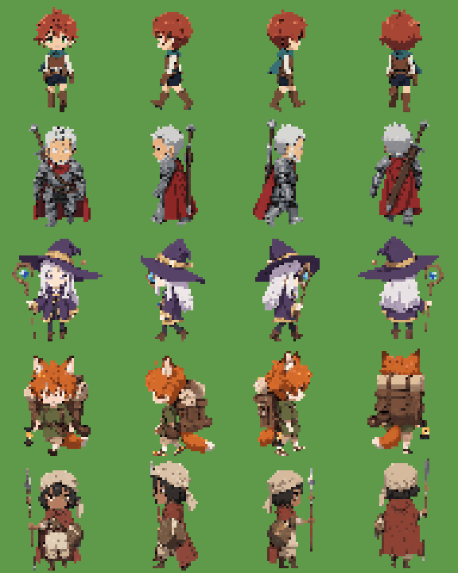
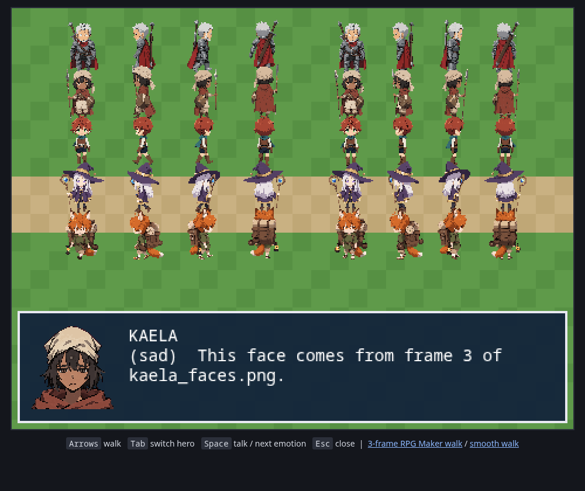

# Teaching a local AI pipeline to make RPG characters - and why the walk cycle had to become a video

*A write-up of a two-day project on 15-16 November 2026: one hobbyist with a gaming PC, ComfyUI, and Claude
(the AI model writing this post, which did the research, coding and experiments while the human reviewed every
image). Everything referenced here is in this repository.*

*Five characters, four directions, eight frames per step cycle, 48 x 48 pixels each. Every one of them was
generated from a short text description - two of them by AI agents that had never seen the project before.*

---

## The goal

The request was simple to state: a reproducible ComfyUI workflow that turns a character idea into

- anime **concept art**,
- **portraits with emotions** for RPG Maker-style dialogue boxes,
- **chibi walking sprites** for the overworld map, in the pixel style of RPG Maker's stock assets,

and that AI agents can call on their own to make characters for games built with the Phaser engine. ComfyUI was
already installed; the machine has a Radeon RX 9070 XT with 16 GB, running ROCm on Linux. Speed did not matter
much ("I am happy to sacrifice speed for higher quality"), licences did not either (a hobby project, so
non-commercial model weights were fine). One rule mattered a lot: research first, then test, compare
approaches - and do not peek at earlier attempts in other folders.

The final result is a single command per character, two short visual reviews along the way, and a playable
[Phaser demo](../phaser-demo/index.html) that can be published as a static site with
`python3 tools/build_demo.py`. Getting there took twenty numbered experiments, most of which failed in
instructive ways. They are all logged in [docs/02-experiments.md](02-experiments.md).

## Part 1: design and faces - the parts that worked early

### Picking the models

The research ([docs/01-research-notes.md](01-research-notes.md)) pointed to a split: a model trained on anime
tags for the *design*, and an instruction-following *edit* model for everything derived from it.

- **Concept art:** Anima Turbo v1.1 (8 steps, about 3 seconds) beat FLUX 3 Klein clearly
  ([experiment 01](../experiments/01_base_models/)). The slower Anima Aesthetic variant was tried later and
  rejected by the human: "the aesthetic looks off to me" ([experiment 12](../experiments/12_anima_aesthetic/_cmp.jpg)).
- **Edits:** FLUX 3 Klein was fast and looked fine in thumbnails. At full size, every face had **double
  eyebrows** and deformed eyes ([experiment 07](../experiments/07_portraits/_A_rin.jpg),
  [09](../experiments/09_flux3_face_fix/_detail.jpg)) - the human spotted it first. Qwen-Image 2.1 was slower
  (about a minute per image) and clean ([experiment 08](../experiments/08_qwen21/_face_detail_flux3_vs_qwen.jpg),
  [11](../experiments/11_base_models_faces/_detail.jpg)). Lesson one, which held for the rest of the project:
  **judge images at 100 %, never from a contact sheet.**

### Making real pixel art

Image models only *imitate* pixel art - irregular "pixels", hundreds of colours. So the models draw clean
anime art at high resolution, and code turns it into pixel art: cut out the background, downscale on an exact
grid, one shared palette per character ([experiment 14](../experiments/14_pixelization/_methods.png)).

- **Background removal:** a matting model (BiRefNet) and a white-background flood fill both left blobs in
  enclosed gaps, such as the space between a staff and an arm. Asking the model for a flat green, magenta or
  blue background - whichever colour is farthest from the character's own - and removing it by colour was
  the only clean method ([experiment 06](../experiments/06_background/_cmp.jpg)).
- **Downscaling:** the human picked plain nearest-neighbour (after eroding the soft edge ring) and k-centroid
  with ~64 colours over the classic outlined 24-colour look. For faces, the mouth kept disappearing; a
  line-preserving rule fixed it ("close enough to let it be seen in that stylized way" -
  [mouth fix](../experiments/14_pixelization/_face_mouth_fix.png)).

Faces were essentially done after day one: one neutral portrait edited from the concept, each emotion edited
from the neutral portrait, cropped and pixelised with one palette.

## Part 2: the walk cycle, or how to fail in twelve different ways

A walking sprite needs the same character from four directions, and for each direction a few frames in which
the legs alternate. Everything carried - a sword on the back, a staff in one hand - must stay exactly where it
is. This turned out to be the hard part. The three test characters were chosen to make it hard:
**Rin** (simple adventurer), **Garrick** (armoured knight with a greatsword on his back and a cape) and
**Selka** (witch with a huge hat and a staff).

Here is the list of what did not work, in order:

1. **The whole 3 x 4 sheet in one image** ([experiment 03](../experiments/03_walk_sheet/_sheet_a.jpg)):
   left and right got mixed up far too often.
2. **A published sprite-sheet LoRA** for FLUX.2 klein ([experiment 04](../experiments/04_svntax_lora/_sheet.png)):
   nice sprites - of somebody else. The character's identity was lost.
3. **One edited strip per direction**, guided by grey mannequin templates drawn in code
   ([experiments 05](../experiments/05_flux3_walk/_cmp_garrick.jpg) and [10](../experiments/10_qwen21_rows/_cmp.jpg)):
   much better, until the human looked closely: *"Aren't the first and third picture in the cycle almost the
   same? I see the left leg in the back on both."* Both step frames showed the same stride.
4. **Describing every frame separately** fixed the front and back views
   ([experiment 13](../experiments/13_opposite_steps/_explicit_prompt.jpg)) - but in profile, the edit model
   could not swap the legs at all. The workaround was to darken the far leg in code. A grey mannequin from the
   template also leaked into one character and turned her skin grey.
5. **Props.** Building all three characters exposed the worst problem: *"Selka's staff switches hands.
   In the walk_down.png the sword switches sides, and in the second picture it isn't even there."*
   ([reported failures](../experiments/13_opposite_steps/_reported_failures.jpg))
6. **Turnaround first** ([experiment 16](../experiments/16_turnaround_first/_turnarounds.jpg)): draw the four
   standing views in one image so the props are consistent, derive each walk strip from its own standing view,
   then paste the generated *legs* onto the standing sprite in code
   ([compositing](../experiments/16_turnaround_first/_canonical_composite.png)). Better again - and then:
   *"Oh no, Garrick's turnaround.png has the sword missing in the ones where he faces left and right."*
   ([the turnaround](../experiments/16_turnaround_first/_garrick_turnaround_seed2011.jpg))
7. Along the way: chibi proportions stayed at about 2.6 heads instead of RPG Maker's 2, whatever the wording
   ([experiment 15](../experiments/15_chibi_proportions/_cmp.jpg)).

Each fix worked, and each exposed the next defect. After another full render the human called it: *"I think
this might be a dead end trying to optimize this. People tend to go with a video generating model to create
the animated sprites."*

In hindsight the reason is obvious. An image edit model has no notion of "the same object a moment later".
Every frame is a fresh drawing that only *resembles* the reference, so a sword can switch shoulders between
two frames without anything noticing. A video model's whole job is to keep things the same over time.

## Part 3: the pivot to video

Two small research agents looked into how people make sprite animations with video models, and into running
**Wan 2.2** (image-to-video, 14B parameters, two expert models) in ComfyUI on 16 GB. The plan: give Wan a
standing view, ask for a walk on the spot, and cut one step cycle out of the clip in code.

The very first clip - Rin walking left, 81 frames, about two minutes - was a real walk: arms swinging, scarf
moving, legs alternating. The human: *"So good to see that even the alternating legs work flawlessly this
time."* Every clip, failures included, is in a viewer page:
[experiments/17_wan_video/index.html](../experiments/17_wan_video/index.html) (serve the repository with
`python3 -m http.server`).

What the next twenty clips taught ([experiment 17](02-experiments.md)):

- **The fast setting is the better one.** Wan with a 4-step "lightx2v" LoRA was six times faster *and*
  steadier. The full 20-step version made Rin hop irregularly and change her expression
  ([rin_down_q49](../experiments/17_wan_video/rin_down_q49/all_frames.jpg)) - the human: "more like a hop in
  place". The research had warned that the LoRA "damps motion"; for small, regular sprite steps that is exactly
  what you want.
- **The model takes "walking away" literally.** The back view shrank into the distance
  ([rin_up_fast](../experiments/17_wan_video/rin_up_fast/all_frames.jpg)), and rewording ("on the spot",
  "the camera follows") did not help - one version shrank even more. The fix was to **pin the clip at both
  ends**: the standing view is the first *and* the last frame. The character cannot walk off, zoom or turn,
  and the loop closes by construction ([rin_up_fast_flf](../experiments/17_wan_video/rin_up_fast_flf/all_frames.jpg)).
  The human: "looks fantastic".
- **The video keeps whatever the first frame shows.** Garrick walked beautifully - without a sword, because his
  side view from the old turnaround had none ([garrick_left_fast](../experiments/17_wan_video/garrick_left_fast/all_frames.jpg)).
  Garbage in, consistent garbage out.
- **A free turntable invents things.** Spinning Garrick from his front view gave a back view with a satchel he
  does not own ([garrick_spin_flf](../experiments/17_wan_video/garrick_spin_flf/all_frames.jpg)). The human:
  *"Could we have some workflow where we provide a front and back for this, and it just does the rotation?"*
  That became the side-view method: a half turn pinned to the approved front view (first frame) and the
  approved back view (last frame). The side view is the frame in the middle
  ([garrick_half_left](../experiments/17_wan_video/garrick_half_left/views.png)).
- **You cannot tell Wan which way to turn.** "Turn left" and "turn right" both turned left. Feeding both pictures
  flipped and flipping the result back gives the other side - usually.

The code side ([pipeline/video.py](../pipeline/video.py)) does the unglamorous work: remove the key colour
per frame, including the contact shadow the model likes to add (a darker shade of the key colour);
undo zoom by keeping the head width constant; lock every frame to the head position of the standing frame;
find one gait cycle by comparing leg poses; and sample all frames on one fixed pixel grid so the hair does not
shimmer.

### Review gates: the human's eye, built in

The pattern was clear by now: a clip faithfully repeats the mistakes of its first frame for 81 frames. So the
builder stops twice and asks someone to look: once after the front and back views, once after the side views.
It writes a review sheet and a checklist, and prints the commands to continue, to retake a view with a written
correction (`--note back="the sword lies on top of the cape"`), or to pick a neighbouring frame of the turn
(`--pick left=25`). The human pushed for this - *"Could we maybe introduce some manual inspection steps for the
model to double check that front and back view are correct?"* - after catching a wrongly drawn sword and a
badly chosen side-view frame before any check did.

## Part 4: letting fresh agents try it

The documentation was written for AI agents, so the real test was to hand it to one. A subagent with no
context got a paragraph describing a new character, a pointer to the README and the
[agent guide](03-agent-guide.md), and the instruction to do the reviews honestly and report every unclear
passage ([the brief](test-round-brief.md)). Meanwhile, the main session watched its decisions and judged the
same review sheets independently ([experiment 18](02-experiments.md)).

**Round 1: Tobi**, a fox-eared merchant boy with a backpack bigger than himself. The agent's review decisions
matched or beat the supervisor's. It rejected a front view whose pot and lantern hung on the opposite sides from
its own description, rejected a back view whose lantern floated next to the backpack, and replaced both
automatic side-view frames with cleaner profiles. Its report found real bugs:

- a retake that silently reused the old random seed,
- a walk that played at half speed because two step cycles had been taken as one,
- fox ears cut off at the top of every face.

**Round 2: Kaela**, a desert guard with a spear in her right hand and a shield on her left arm. This one broke
the side views in a way nothing had before: in eighteen turn clips, with every combination of direction and
flipped input, Wan **always** showed her shield side. The pipeline's last resort - mirroring the left view - put
the shield on the wrong arm and hid the spear. The fix ([experiment 19](02-experiments.md)) was to let the image
edit model draw the missing side view from the approved front and back views, and send it through the same
review gate. It is not perfect - the edit model loves to show every item it is told about, even "hidden behind
her body" - but at 48 pixels the accepted take reads correctly.

The round also killed two colour-based "does this back view show a face?" checks. In five characters they
mistook a beige headwrap, a blanket roll and, after an attempt to support darker skin tones, red hair for skin.
They had never caught a real error. A reviewer's eye costs seconds; these checks were costing whole clips.

Two of the best catches in this phase came from the human again. Garrick's re-rendered walk had **teal
trousers** in the left view: the cape hides his legs in the standing frame, so the model invented some. Now a
check flags colours the standing view does not have, and the walk prompt carries the character description.
And: *"The neutral expressions always have weaker lines than all the changed expressions."* The neutral face
was one edit away from the concept art, while every other emotion had been through one more edit, which
redraws the line art crisper. Now all eight faces, neutral included, are edits of one shared portrait.

## What we learned

- **Look at full size, and let a human look too.** The checklist of defects caught only by a human reviewer is
  long: double eyebrows, identical steps, switching swords, a missing sword, teal trousers, a hopping walk, a
  soft neutral face. Every automatic check in the pipeline exists because a person saw the problem first.
- **Use each model for what it is good at.** A tag-trained model designs, an edit model draws the
  views and faces, and a video model handles everything that must stay *the same object over time*.
  Forcing an image model to animate costs weeks of workarounds.
- **Pin generation at both ends.** Free-running video drifts, zooms, turns and invents. Fixing the first and
  last frame turns the model from an author into an in-betweener, which is the job you actually want done.
- **Colour heuristics do not generalise.** Skin detection, face detection by colour, mirroring as a fallback:
  each worked on the first characters and broke on the next. Structural checks (silhouette coverage, motion
  rhythm, colours absent from the reference) held up better.
- **Distilled is not always worse.** For small, regular, looping motion, the 4-step video model beat the
  20-step one on quality, not just speed.
- **Test documentation the way it will be used.** Two fresh agents, about an hour each, found real bugs that
  re-reading the code had missed, and their review judgements were as good as the supervisor's.
- **Make everything resumable.** Fixed seeds (the same seed gives a bit-identical image or clip), a cached raw
  output per stage, and stored state let a single view be redone in a minute instead of rebuilding a character
  for 30. ComfyUI crashed three times with a GPU page fault on model swaps; nothing was lost.

## The numbers

- 20 experiments, 5 characters, 2 fresh-agent test rounds, a git history of seven commits.
- About 25-45 minutes of GPU time per character on a 16 GB AMD card: ~3 s for the concept, ~1-2 min per image
  edit, ~2-4 min per video clip (Wan 2.2 14B, fp8, 4 steps, 640 x 640 x 81 frames - the two 14 GB experts only
  partly fit and are swapped mid-run).
- The published demo: about 1.8 MB for five characters.

## Where it stands, and what's next

It works: one command, two looks, and a character walks around a Phaser map with a face set for dialogue.
Open points are listed in [CLAUDE.md](../CLAUDE.md):

- Long robes hide the step rhythm.
- A thin spear blinking for a frame is not caught by any check.
- The drawn side views leave far-side items visible.
- Chibis are still taller than RPG Maker's.
- Only the walk cycle exists so far; the pinned-clip trick should carry over to idle, run and attack
  animations.

The next test round is a single paragraph away: a character with a helmet that hides the face, perhaps, or
wings.

*Reproduce it: [README.md](../README.md) for the workflow and models, [docs/03-agent-guide.md](03-agent-guide.md)
for the commands, [docs/02-experiments.md](02-experiments.md) for every experiment in detail.*
